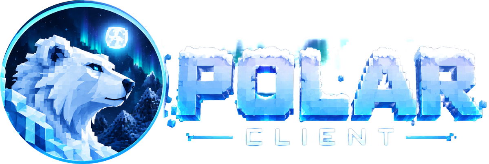
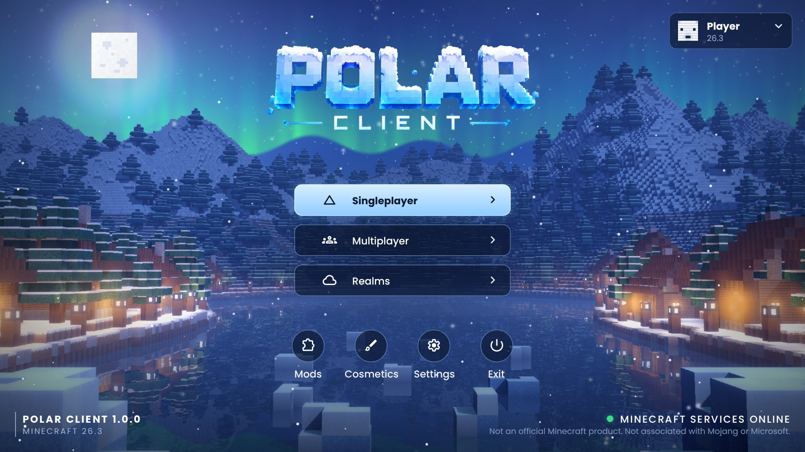

<p align="center"></p>

# Polar Client

An all-in-one Minecraft client in the spirit of Lunar, Feather and Badlion — PvP HUD mods, performance and quality-of-life features — for **Minecraft Java 26.3, 1.21.11, 1.21.10, 1.16.5 and 1.8.9** on **Fabric** (Legacy Fabric for 1.8.9), with its own launcher and a polar bear logo. Every version gets the whole client: the main menu, the server list, the Right Shift menu, the HUD editor, all 79 mods and account switching.

Polar Client only includes features that are allowed on normal servers (no cheats like kill-aura, fly or x-ray). Freelook is the one feature some servers don't allow; it can be turned off in the mod menu.

| Folder | What it is |
|---|---|
| `mod/` | The Polar Client mod: `mod/common/` is the shared code (menus, HUD mods, settings, accounts — written once), and `mod/26.3`, `mod/1.21.11`, `mod/1.21.10`, `mod/1.16.5`, `mod/1.8.9` are one small Gradle project per Minecraft version that connects it to that version |
| `launcher/` | The Polar Client desktop launcher (Electron): Microsoft sign-in, installs Java, Minecraft, Fabric, the mod and a performance pack |
| `branding/` | The logo (`source/polar-logo-original.png`) and exports: full logo and wordmark cut-outs, badge PNGs 16–1024 px, `polar.ico`, `polar.icns` |
| `tools/menu-background/` | Renders the main-menu background layers (voxel world ray tracer + post-processing) |
| `.github/workflows/` | `build.yml` checks that the mod and the installers build on every push; `release.yml` builds and publishes a release when you run `release.bat` |
| `publish.bat`, `release.bat` | Upload the project to GitHub, and release a launcher update (see *GitHub* below; both run `tools/github.js`) |

## Main menu

<p align="center"></p>

Polar replaces the title screen and the Multiplayer server list with its own. The main menu has the polar bear logo, an ice-blue **Singleplayer** button, glass **Multiplayer** and **Realms** buttons, round **Mods / Cosmetics / Settings / Exit** shortcuts, an account card (your skin's face, name, version; its menu opens Polar Mods, Edit HUD and skin layers) and a live **Minecraft services** status light.

The **server list** shows each saved server as a card with its icon, MOTD, player count and ping, LAN worlds below, and Join / Direct / Add / Edit / Delete / Refresh buttons (double-click a server to join, hover its icon to join or use the arrows to reorder).

**Switch accounts without restarting:** the account card at the top right of both screens lists the accounts saved in the launcher; click one to switch. The launcher hands the game a fresh login through a private connection that only works on your PC while the game it started is running. Switching works from menus, not inside a world.

The background is a snowy night in a blocky world and it's animated: the aurora drifts across the sky and is reflected in the frozen lake, stars twinkle, village windows and lanterns flicker, the ice glints, mist rolls over the lake, snow falls (near flakes are out of focus), shooting stars cross the sky now and then, and the layers move with your mouse (parallax). The same background is used behind the mod menu and HUD editor when you're not in a world. **Settings** has switches for the snowfall and for the Polar main menu itself (turn it off to get the vanilla title screen back). The layers are pre-rendered by the scripts in `tools/menu-background/`.

## Features (79 mods)

Press **Right Shift** in game to open the mod menu: a frosted-glass window with a sidebar (**Mods**, **HUD Editor**, **Settings**, **Cosmetics**, **Profiles**), an aurora-and-mountains banner, a search box, category chips (All, Favorites, HUD, Visual, Combat, Utility, World, Social, Performance, Accessibility, Customization) and a grid of cards with switches. Click a card's switch (or the card) to turn a mod on or off, the gear (or right-click) for its settings, and the star to add it to Favorites. **Enabled (n)** shows only the mods that are on. The menu keeps the same proportions at every GUI scale; **Settings** has a menu size option and **Reduced motion**. Pick the accent color (Ice, Aurora, Ember, Violet, Rose, Lime, Gold) in **Settings**. The sidebar folds down to icons with the arrow at the bottom.

**Profiles** save which mods are on, all their settings and your HUD layout. Save as many setups as you like (PvP, Survival, Recording...), load or update them, and **Export / Import** copies a setup to the clipboard to share it.

- **HUD:** Watermark, FPS, CPS, Ping, Keystrokes, Armor Status, Potion Effects, Coordinates, Direction HUD, Biome Display, Chunk Coordinates, Compass, Clock, Server Address, Speed, Session Time, Memory, Entity Counter, Held Item Display, Health HUD, Saturation HUD, Durability Warning, Pack Display, HUD Tweaks, and movable, restyled **Scoreboard** (hide the red numbers, your own background), **Boss Bar** (flat bars, optional percent) and **Tab List** (player heads, ping in milliseconds)
- **Visual:** Zoom (hold **C**), Freelook (hold **Left Alt**), Fullbright, Custom Crosshair (5 styles, hit color), No Hurt Cam, Smooth Camera, Entity Shadows, Low Fire, Clear Water, Time & Weather (your own time of day and weather, only on your screen), Particles (show 0-100%), Hit Colour (the flash mobs make when hit), Glint Colour (enchantment shimmer, chroma too), Hitboxes (the game's F3+B hitboxes in your colour, players only if you like, toggle with **H**)
- **Combat:** Reach Display, Combo Counter, Item Counter, Totem Counter, Low Health Warning, Hit Indicator, Hit Sound, Attack Cooldown, Cooldowns (pearl, shield, chorus), Kill Counter (with kill message), Death Counter, Auto GG
- **World:** Minimap (the ground around you coloured like a vanilla map, your waypoints and last death on it, north up or turning with you, zoom, coordinates; in the Nether it shows the floor at your height), Waypoints (light beams, names and distance in the world; press **B** to add one, manage them from the mod's settings), Coordinates Hotkey (press **J** to copy your coordinates or post them in chat), Death Waypoints, Journey Tracker, World Border Display, Distance Calculator
- **Inventory:** Inventory Search (a search box on chests and inventories that dims everything else, and looks inside shulker boxes), Shulker Preview (hover a shulker box to see its items), Exact Durability (durability numbers in tooltips)
- **Social:** Chat Timestamps, Chat Filter (hide words and ignore players), Copy Chat (click a message with chat open to copy it), Compact Chat (repeats become one line with "(x3)"), Chat Background (colour and opacity), Mention Alerts, Discord Status (tells the launcher where you are for your Discord profile; can keep the server address private)
- **Performance:** FPS Limiter (with a lower background FPS), Frame Time graph, CPU Monitor, Stutter Monitor, Hide Far Entities (stops drawing mobs, armour stands and items past a set distance; players too if you like)
- **Accessibility:** Toggle Sprint/Sneak, Screen Shake Control (view bobbing), Sensitivity Profiles
- **Customization:** Custom Font (smooth font for HUD mods), Favorites, Profiles, accent colors
- **Client:** Polar main menu with an animated snowy-night background, "Polar Client" window title, drag-and-drop HUD editor with snapping, per-setting colors with chroma, config saved to `config/polarclient.json`

Attack Cooldown, Cooldowns, Totem Counter and Shulker Preview need Minecraft 1.9+ / 1.11+, so they're greyed out on 1.8.9. On 1.8.9 the chat time stamp uses the nearest of the 16 chat colours.

Waypoints are kept per server and per singleplayer world in `config/polarclient-waypoints.json`.

All keys can be rebound in **Options → Controls → Key Binds → Polar Client** (Zoom C, Freelook Left Alt, Copy Coordinates J, Add Waypoint B, Toggle Hitboxes H).

The launcher also installs an optional performance pack from Modrinth (Sodium, Lithium, FerriteCore, EntityCulling, ImmediatelyFast, More Culling, Dynamic FPS, C2ME, Sodium Extra) and, if you tick them on the Mods page, popular mods by other people: Iris Shaders, Xaero's Minimap and World Map, AppleSkin, Jade, EMI, Replay Mod, Simple Voice Chat and Mod Menu. Each is only installed on versions Modrinth has a build of it for, and anything it needs (Iris needs Sodium) comes with it.

## GitHub: the code, releases and updates

**Download Polar Client:** <https://github.com/NeerBhardwaj1/polar-client/releases/latest>

The launcher reads two things from the public repository `NeerBhardwaj1/polar-client` (set by `polar.updateRepo` and `polar.newsUrl` in `launcher/package.json`): the **latest release**, to offer launcher updates, and **`news.json`**, for the News on the home page. Both need the repository to be public.

You need [Git for Windows](https://git-scm.com/download/win) (or `winget install --id Git.Git -e`) and Node.js.

**First upload:** double-click **`publish.bat`**. It turns this folder into a Git repository and uploads everything except build output and the Minecraft files in `tools/mcref`. If the GitHub repository doesn't exist yet, it opens GitHub's "new repository" page with the name filled in. Keep it **Public**, leave *Add a README*, *.gitignore* and *license* off, click **Create repository**, then press Enter in the window. The first upload asks you to sign in to GitHub in your browser. Commits use your GitHub *noreply* address, so your email stays private.

**Afterwards:**

- **`publish.bat`** uploads your changes (code, `news.json`, …) without making a release. Edited News shows in every launcher at its next start.
- **`release.bat`** releases a new version. It asks for the version (it suggests the next one) and what's new, then raises `version` in `launcher/package.json`, can post the release in the News, tags it `vX.Y.Z` and uploads it. GitHub Actions (`.github/workflows/release.yml`) then builds the mod for all five Minecraft versions and the Windows, macOS and Linux installers (about 20–30 minutes; watch it in the repository's **Actions** tab) and publishes them as a GitHub release. Every launcher older than that version then shows **Update now**, which downloads the new installer and runs it.
- Run `release.bat` once with **1.0.0** to publish the first installer for people to download. Updates start from 1.0.1.
- You can also release from the website: **Actions → release → Run workflow**, with a version and what's new.
- Every upload also runs the **build** workflow, which checks that everything still builds; its installers are under the run's *Artifacts*. Edits that only touch `news.json`, Markdown files, `docs/` or `branding/` skip it.
- A release only goes out if the Windows installer built. A macOS or Linux build failing doesn't stop it.

## The Polar server: cosmetics, the badge, friends and settings sync

Polar's online features run on a small server of your own on **Cloudflare's free plan** (Workers + a Durable Object with its built-in database; free covers 100,000 requests a day, plenty for a growing client). The code is in `server/`.

- **Cosmetics.** 80 original cosmetics: 30 capes (most of them animated, HD), 10 wings, 19 hats, 8 back items and 13 auras, in collections (Polar, Celestial, Inferno, Cosmic, Nature, Neon, Royal, Cute, Classic, Special). Players pick theirs in the launcher (**Cosmetics → Polar wardrobe**) with a 3D preview; some take a colour. Other Polar players see them in game on all five Minecraft versions.
- **Free and special.** Everything is free except the *Special* collection (Founder, Supporter, Polar Staff, Creator), which you hand out from the admin page or with codes.
- **The Polar badge.** A small snowflake in front of the names of players on Polar, in name tags and the player list (players can hide theirs in the wardrobe).
- **Friends.** Add friends by Minecraft name in the launcher's **Friends** page, see who's online and which server they're on, join them with one click, and invite them to your server. Invites also show in game: press **Y** (Controls → Polar Client) to join.
- **Settings sync.** Your Polar menu settings, HUD layout and waypoints follow your account to other PCs (Settings → *Sync my Polar settings between PCs*).

Signing in uses Minecraft's own server check: the launcher tells Mojang the player is joining a one-time "server" and the Polar server asks Mojang whether that happened, so Minecraft logins never reach the Polar server.

**Offline profiles** use Polar too, on singleplayer, LAN and offline-mode servers (where their offline id is what other players' games see). An offline profile has no Minecraft login to check, so the launcher makes it a secret key, kept encrypted on the PC, and the first PC to use a name on Polar keeps it: nobody else can be that player on Polar, and "Steve" and "steve" count as the same name. To use the same offline profile on another PC, click the lock next to it in **Accounts** to copy its Polar key, add the profile on the other PC and paste the key on its Cosmetics page. Friends lists show an *Offline profile* tag, and the admin page counts them and marks them.

**Set it up (once):**

1. Make a free account at <https://dash.cloudflare.com/sign-up>. If Cloudflare asks for a *workers.dev* subdomain (Workers & Pages), pick one; it becomes part of the server's address.
2. Double-click **`deploy-server.bat`**. The first time, your browser opens so you can allow Cloudflare's tool (wrangler) to use your account. It uploads the server, sets up its secret keys, prints the server's address and the admin password (also saved in `server/admin-password.txt`, which is never uploaded to GitHub), and points the launcher at the server.
3. Run **`publish.bat`** and then **`release.bat`** so players get a launcher that knows the server.

Run `deploy-server.bat` again whenever you change the server or the cosmetics (sign-ins and data are kept). `deploy-server.bat --new-admin-password` makes a new admin password.

**Admin page:** `https://<your server>/admin`, with the admin password. It shows how many players use Polar and how many are online, looks up a player by name to give or take back special cosmetics or block them, and makes codes (one or many, each usable once or many times, with a note) that players redeem in the wardrobe.

**Making cosmetics:** they're drawn in code in `tools/cosmetics/` (`capes.py`, `wings.py`, `heads.py`, `backs.py`, `auras.py`; needs Python with numpy, scipy and Pillow). `python tools/cosmetics/build.py` builds every texture, model and the catalogue into `server/public/cosmetics/`; `python tools/cosmetics/thumbs.py` (needs Playwright) renders the wardrobe thumbnails; `tools/cosmetics/preview/index.html` shows them in 3D (serve the repository folder, e.g. `python -m http.server`, and open `/tools/cosmetics/preview/index.html?items=cape_aurora,wings_frost`). Then run `deploy-server.bat`.

**Trying it without Cloudflare:** `node server/test/dev-server.mjs` runs the server locally on port 8787 with a fake Mojang (admin password `dev-admin`). The server's tests: `cd server && npm test`.

## Build locally

**Mod** — needs JDK 25 (e.g. [Microsoft Build of OpenJDK](https://learn.microsoft.com/java/openjdk/download)); it builds the jars for the older versions too:

```bash
cd mod/26.3              # or mod/1.21.11, mod/1.21.10, mod/1.16.5, mod/1.8.9
./gradlew build          # jar in build/libs/
./gradlew runClient      # starts that Minecraft version with Polar Client for testing
```

Open a version's folder (e.g. `mod/26.3`) in IntelliJ IDEA 2025.3 or newer as a Gradle project to edit it; the shared code in `mod/common` is part of every version's project. See [`mod/README.md`](mod/README.md) for how the versions fit together.

**Launcher** — needs Node.js 22+:

```bash
cd launcher
npm install
npm test                 # 58 tests (versions, accounts, servers, Modrinth, packs, skins, News, Discord, crash helper, Polar server)
npm run bundle-mod       # copies each version's built mod jar into the launcher
npm start                # run the launcher
npm run dist             # build an installer for your OS into dist/
```

### Windows installer (.exe) on your own PC

With Java 25 and Node.js installed, double-click **`build-exe.bat`** in this folder. It builds the mod for all five versions (the first run downloads each Minecraft version, so it takes a while), packs them into the launcher and copies `Polar Client Setup 1.0.0.exe` to your Desktop. Electron and its packaging tools are downloaded from the npmmirror CDN because GitHub's download servers are blocked on some networks. If Windows Developer Mode is off, the installer still works but the app uses the default Electron icon; turn Developer Mode on (Settings > System > For developers) for the polar bear icon.

## The launcher

A Polar-styled launcher with an animated snowy-night home page (aurora, snowfall, parallax):

- **Home:** Play Minecraft, the **version dropdown**, Quick Join (start and join a server straight away, or always), a live game status card, your recent servers with ping, and the Polar features.
- **Versions:** pick **26.3, 1.21.11, 1.21.10, 1.16.5 or 1.8.9** from the dropdown next to Play. Every version is the full Polar Client, with its own build of the mod. 26.3, 1.21.11, 1.21.10 and 1.16.5 run on Fabric with Fabric API and the performance mods that have a build for that version; 1.8.9 runs on Legacy Fabric with Legacy Fabric API. Each version downloads on its first Play, gets the right Java (25, 21 or 8) and has its own game folder; a new folder starts with a copy of your 26.3 server list.
- **Servers:** the selected version's own server list (its `servers.dat`, the same list you see in game). Add, edit and remove servers, see ping, players and MOTD, and Play to launch straight into one.
- **Mods:** Polar's built-in mods and the performance pack toggles (with a note on versions where they don't apply).
- **Browse:** search Modrinth from the launcher (sort by relevance, downloads, followers or date, filter by category) and press **Install** to put a mod in the selected version's own mods folder, with any libraries it needs. Only mods with a build for that version and loader are shown. The **Installed** tab lists what you added (with Remove) and the jars you put in the folder yourself.
  - **Resource packs and Shaders:** the tabs above the search find packs on Modrinth for the selected version and download them into that version's `resourcepacks` or `shaderpacks` folder. A resource pack is switched on for your next game (it's added to `options.txt`); installing a shader pack also turns on Iris (and Sodium) for that version and picks the pack in Iris's settings. The Installed tab has switches for your resource packs, **Use** for each shader pack and **Turn shaders off**. Shaders need Iris, which doesn't run on 1.8.9, so the Shaders tab is empty there.
  - **Mod profiles:** save the mods you have now (Browse mods plus the performance pack and extras) as a profile such as "PvP" or "Shaders", and switch with one click. Each version keeps its own profiles; switching removes the Browse mods the profile doesn't list and installs the ones it does.
  - **Mod updates:** the launcher checks your Browse mods for newer builds (at start-up and when you switch versions). A badge on Browse shows how many; press **Update** on a mod or **Update all**.
- **Screenshots:** every screenshot you took in game (F2), from all versions, newest first. Filter by version, open one full size (arrow keys to flip), copy it to the clipboard, show it in its folder, or delete it (it goes to the Recycle Bin).
- **Crash helper:** when the game closes with an error, the launcher reads the log and the crash report and tells you the likely cause in plain words, for example "Xaero's Minimap needs Fabric API", with what to do and a button to the right page. The full log and the crash report are one click away.
- **Launcher updates:** the installed launcher checks GitHub for a newer release. When there is one, a banner offers **Update now**, which downloads the new installer and runs it. Release one with `release.bat` (see *GitHub* above).
- **Cosmetics:** your skin (front/back preview, upload a new one, reset) and your capes (equip or hide), saved to your Minecraft account through Minecraft's own profile API. Microsoft accounts only.
  - **Skin library:** **Save current skin** keeps the skin you wear now, **Add skin files** adds PNGs from your PC, and **Use** puts one on with a click. Rename a skin with the pencil and click its arm style to switch between classic and slim. The library is kept on this PC (in the launcher folder's `skins`) for all your accounts.
- **News:** the home page shows your latest announcements and changelog (see *Publishing News* below); new posts also go to the bell.
- **Discord status:** while the Discord app is open, your Discord profile shows "Playing Polar Client" with the version and where you are, for example *Minecraft 1.21.11 · On play.example.net*, and how long you've played. Switch it off in Settings; in game, the Discord Status mod can hide the server address (Minecraft's own *Hide server addresses* option hides it too). It needs a Discord application id (see *Before a public release*).
- **Settings** and **Console** as before; the bell keeps a list of launcher events (game started/closed/crashed, sign-ins, skin changes); the account card switches accounts.
- Footer: version info, a live Minecraft-services status and link buttons. Set your Website/Discord links at the top of `launcher/src/renderer/app.js` (empty ones are hidden).

## How the launcher works

1. **Sign in** with Microsoft (Microsoft → Xbox Live → Minecraft). The account must own Java Edition. Tokens are stored encrypted with your OS keychain.
   **Offline profiles:** once a Microsoft account that owns Java Edition is in the launcher, you can add any number of offline profiles by name (Accounts → Offline profile). They use the standard offline UUID and default skin, for singleplayer, LAN and offline-mode servers. Removing the last Microsoft account locks them again.
2. **Play** downloads only what's missing for the selected version, verifying every file's SHA-1:
   Mojang's Java runtime for that version → libraries and client → assets → latest stable Fabric Loader (Legacy Fabric on 1.8.9) → Fabric API + performance mods (Modrinth) → the bundled Polar Client mod built for that version. Older versions also get their native libraries unpacked, and Quick Join uses `--server` on versions from before quick play.
3. The game runs from its own folder (`%APPDATA%\.polarclient` on Windows, `~/Library/Application Support/.polarclient` on macOS, `~/.config/.polarclient` on Linux), so it never touches your normal `.minecraft`: `instance/` for 26.3 and `instances/<version>/` for the others. Mods you add yourself to a version's `mods` folder are left alone.

Settings: RAM, window size/fullscreen, custom Java, JVM arguments, hide launcher while playing, and **Quick join** (connect to a server on launch).

## Publishing News

The News on the launcher's home page comes from `news.json` at the top of this repository (the address is `polar.newsUrl` in `launcher/package.json`). Edit it and run `publish.bat`: every launcher picks it up at its next start, keeps a copy for when it's offline, and falls back to the copy built into the launcher (`launcher/src/news.json`, keep it the same when you release). Each item:

```json
{ "id": "2026-11-02-minimap", "date": "2026-11-02", "tag": "Update", "title": "A minimap",
  "body": "Plain text, a few sentences.", "link": "https://...", "linkLabel": "Release notes", "image": "https://..." }
```

`date` (YYYY-MM-DD) and `title` are required; `link` and `image` must be https; the newest 30 items are shown. Give each item a new `id`: the bell shows ids it hasn't seen.

## Before a public release

- **Microsoft sign-in app ID.** The launcher uses the client ID that other open-source launchers use for testing. For a public release, register your own app in Azure and apply for Minecraft API access at <https://aka.ms/mce-reviewappid>, then set `POLAR_MSA_CLIENT_ID` (and `POLAR_MSA_REDIRECT` if needed) in `launcher/src/core/auth.js`.
- **Discord application.** Create an application at <https://discord.com/developers/applications> named **Polar Client** (that name is what Discord shows after "Playing"), add a Rich Presence art asset called `logo` (the polar bear, 512×512 or larger), and put the application's id in `polar.discordClientId` in `launcher/package.json`. Until then the Discord switch in Settings is greyed out.
- **Code signing.** Unsigned installers show SmartScreen/Gatekeeper warnings ("Windows protected your PC" → *More info* → *Run anyway*), on the first install and on each update. Add a Windows code-signing certificate and an Apple Developer ID to the release workflow's secrets.
- **Branding rules.** Keep "Not an official Minecraft product" visible (it's on the main menu) and don't use Mojang/Microsoft logos (see the [Minecraft Usage Guidelines](https://www.minecraft.net/usage-guidelines)).

## Ideas for v2

A world map to go with the minimap, a 1.8-style animations mod, emotes, and a friends list inside the in-game Polar menu.

## Notes

- Built against the real games: each version's code was checked by compiling it against that version's own game jar (26.3's decompiled sources; 1.21.11, 1.21.10 and 1.16.5 with Mojang's names; 1.8.9 with Legacy Fabric's names) and its Fabric API, and every mixin target was checked against the real method signatures. The shared code compiles as Java 8, so it runs on all of them. The first `./gradlew build` of each version is still the final word — if it reports anything, it's usually a one-line fix.
- Fonts: Poppins (SIL Open Font License) and Google Material Symbols (Apache License 2.0); license texts are next to the font files in `mod/common/src/main/resources/assets/polarclient/font/` and `launcher/src/renderer/assets/fonts/`.
- Polar Client is not affiliated with Mojang Studios or Microsoft.

Licensed under the MIT License.
